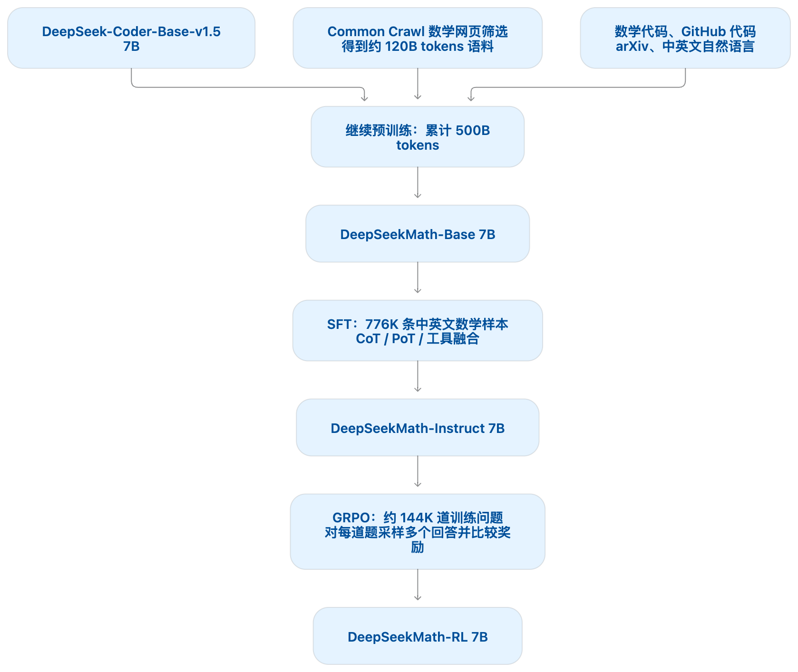

# DeepSeekMath：数学预训练与 GRPO

> 研究问题：如何让一个 7B 参数的开放语言模型获得较强的数学推理能力？

论文：[DeepSeekMath: Pushing the Limits of Mathematical Reasoning in Open Language Models](https://arxiv.org/abs/2402.03300)

## 数学继续预训练

### 迭代筛选

目标是从 Common Crawl 的海量网页中收集数学内容。作者采用“分类器筛选 → 域名统计 → 人工补充 → 重新训练”的循环，扩大种子数据的覆盖范围，减少漏召回。

1. **准备种子并训练分类器**：将 OpenWebMath 作为初始种子数据，即一批已知的高质量数学文本。从中随机抽取 50 万条作为正例，再从 Common Crawl 随机抽取 50 万个网页作为负例，训练 fastText 分类器。随机负例并不保证全部是非数学网页。
2. **召回候选网页**：用分类器给去重后的 Common Crawl 网页打分，保留排名靠前的内容。“召回”指从已有网页中找出可能符合要求的候选内容。
3. **发现数学网站并补充种子**：按域名统计网页入选比例，将超过 10% 的域名视为数学相关域名。随后由人工标注这些网站中的数学相关 URL 路径，把这些路径下此前漏掉的网页补入种子。
4. **重新训练并重复筛选**：用扩充后的种子更新分类器，再进行下一轮召回。作者共进行了 4 轮，最终得到约 3,550 万个数学网页、120B tokens。

关键在于：利用网站结构和人工判断补充原分类器未选中的内容，使下一轮分类器能够识别更多样的数学文本。人工标注的是数学相关路径，并不等于逐条核验网页中的数学解答。

### 评测集去污染

目的是尽量避免把评测题目或答案混入训练数据，防止模型依靠记忆获得虚高的分数。论文采用文本匹配过滤：

- **评测文本至少包含 10 个单位**：若训练文本中出现与评测内容连续 10 个单位完全相同的片段，即匹配的 10-gram，则移除相应训练文本片段。
- **评测文本包含 3～9 个单位**：由于不足以构成 10-gram，改为匹配整条评测文本，并过滤匹配到的网页。

这里的 n-gram 是连续 n 个文本单位组成的片段；单位取决于分词方式，不一定是单个汉字。这种方法主要识别直接复制的内容，无法保证检测出所有改写或翻译后的题目。

### 语料质量验证

作者固定使用 DeepSeek-LLM 1.3B，在不同数学语料上分别继续训练 150B tokens，再比较模型在 GSM8K、MATH、CMATH 等下游基准上的表现，以检验各语料的训练效果。

这些实验采用相同的累计训练 token 预算，但不同语料的规模和重复次数仍有差异，因此不能把最终得分差异全部归因于单条数据的质量。

## SFT

### 训练数据与输出形式

SFT（监督微调）让模型学习如何按照示范组织解题过程。论文构建了 776K 条中英文数学指令样本，包含三种输出形式：

| 输出形式 | 含义 |
|---|---|
| CoT（Chain-of-Thought） | 用自然语言逐步解题 |
| PoT（Program-of-Thought） | 生成程序，通过执行求解 |
| 工具融合推理（Tool-integrated reasoning） | 自然语言推理与工具调用交替进行 |

### 训练目标

给定问题和示范回答的前缀，提高模型预测正确下一个 token 的概率。论文附录采用长度归一化的写法：

```math
\mathcal{J}_{\mathrm{SFT}}(\theta)
=
\mathbb{E}_{(q,o)\sim P_{\mathrm{SFT}}}
\left[
\frac{1}{|o|}
\sum_{t=1}^{|o|}
\log\pi_\theta(o_t\mid q,o_{\lt t})
\right].
```

- $`q`$：问题；$`o`$：训练数据中的示范回答。
- $`o_t`$：回答的第 $`t`$ 个 token；$`o_{\lt t}`$：它之前的示范回答前缀。
- $`\pi_\theta(o_t\mid q,o_{\lt t})`$：当前模型给正确下一个 token 的概率。
- 求和后除以回答长度，再对训练样本取平均。

训练要**最大化**这个目标；若写成需要最小化的损失，则取负号：$`\mathcal{L}_{\mathrm{SFT}}=-\mathcal{J}_{\mathrm{SFT}}`$。

**SFT 使用示范回答中的前缀；后续 RL 则对模型自己采样生成的回答进行评价和训练。**

## GRPO

GRPO（Group Relative Policy Optimization，组相对策略优化）对同一道题生成多个回答，比较它们的奖励，强化相对较好的回答。它保留了 PPO 的概率比和裁剪机制，用组内奖励统计量替代独立价值模型的基线估计。

### 奖励模型与价值模型

| 模型 | 回答的问题 | 在本文中的作用 |
|---|---|---|
| 奖励模型 $`r_\phi`$ | 这个回答或推理步骤有多好？ | 给采样结果打分 |
| 价值模型 $`V_\psi`$ | 从当前前缀继续生成，预计能得到多少回报？ | PPO 结合价值预测和奖励，用 GAE 估计优势 |

**GRPO 省去的是独立价值模型；DeepSeekMath 仍然使用奖励模型。** 它减少了价值模型的训练开销，但每道题仍需要采样多个回答。

### 三个策略分别负责什么？

| 策略 | 含义 | 用途 |
|---|---|---|
| $`\pi_\theta`$ | 当前策略，参数正在更新 | 计算当前概率并反向传播 |
| $`\pi_{\mathrm{old}}`$ | 生成本批回答时的策略快照 | 计算新旧策略的概率比 |
| $`\pi_{\mathrm{ref}}`$ | 参考策略 | 通过 KL 约束偏离程度 |

旧策略和参考策略的用途不同。在一次策略更新中，二者都视为固定；迭代式 RL 可以在外层迭代中更新参考策略。

### PPO 提供的基本结构：概率比与裁剪

对第 $`i`$ 个回答的第 $`t`$ 个 token，定义概率比：

```math
\rho_{i,t}(\theta)
=
\frac{\pi_\theta(o_{i,t}\mid q,o_{i,\lt t})}
{\pi_{\mathrm{old}}(o_{i,t}\mid q,o_{i,\lt t})}.
```

比较的是**同一问题、同一前缀、同一 token** 在两个策略下的概率：

- $`\rho=1`$：概率相同。
- $`\rho\gt 1`$：当前策略更倾向于生成它。
- $`\rho\lt 1`$：当前策略更不倾向于生成它。

用一个记号表示裁剪后的策略项：

```math
\ell_\varepsilon(\rho,A)
=
\min\left(
\rho A,\;
\mathrm{clip}(\rho,1-\varepsilon,1+\varepsilon)A
\right).
```

其中 $`A`$ 是优势，决定强化或抑制的方向；$`\varepsilon`$ 是裁剪阈值。$`\ell_\varepsilon`$ 是本笔记为简化表达引入的记号。

例如 $`\varepsilon=0.2`$ 时：

| 优势 | 希望的变化 | 裁剪的作用 |
|---|---|---|
| $`A\gt 0`$ | 提高对应 token 的概率 | 当 $`\rho\gt 1.2`$ 时，该项不再奖励继续增大概率 |
| $`A\lt 0`$ | 降低对应 token 的概率 | 当 $`\rho\lt 0.8`$ 时，该项不再奖励继续减小概率 |

**裁剪改变的是目标函数，不是把实际概率比硬性限制在区间内。** 例如 $`A=1`$、$`\rho=1.5`$ 时，策略项为 $`\min(1.5,1.2)=1.2`$，但实际概率比仍然是 1.5。

### GRPO 如何计算优势？

对同一道题，用旧策略采样 $`G`$ 个回答，奖励模型给出 $`R_1,\ldots,R_G`$。

在**结果监督**下，每个回答只有一个最终奖励。先计算组内平均奖励 $`\bar{R}`$ 和标准差 $`s_R`$，再得到：

```math
\widehat{A}_{i,t}
=\widehat{A}_i
=\frac{R_i-\bar{R}}{s_R},
\qquad
\bar{R}=\frac{1}{G}\sum_{j=1}^G R_j.
```

含义是：**该回答比组内平均水平好多少，这个差距相当于几个组内标准差。**

同一回答的所有 token 共享这个优势，但它们的概率、裁剪状态和 KL 项不同，因此实际梯度仍可能不同。

例如，一组奖励为 $`(1,1,0,0)`$。使用总体标准差演示时：

```math
\bar{R}=0.5,\qquad s_R=0.5,
\qquad
(\widehat{A}_1,\widehat{A}_2,\widehat{A}_3,\widehat{A}_4)
=(1,1,-1,-1).
```

前两个回答获得正优势，后两个获得负优势。这只是二值奖励示例；本文奖励模型的输出不必只有 0 和 1。

**正优势表示相对本组表现较好，不直接等于客观正确。** 实现时还需处理标准差为零的情况，例如加入数值稳定项；采用这种处理时，若整组奖励完全相同，任务优势为零。

### 从奖励到梯度：为什么能够这样训练？

以下是帮助理解的标准策略梯度背景，暂时忽略裁剪、KL 和长度归一化。

语言模型逐个 token 生成回答，所以整份回答的概率可以分解为：

```math
\pi_\theta(o\mid q)
=\prod_{t=1}^{|o|}
\pi_\theta(o_t\mid q,o_{\lt t}).
```

取对数后，乘积变为求和，再求梯度：

```math
\nabla_\theta\log\pi_\theta(o\mid q)
=\sum_{t=1}^{|o|}
\nabla_\theta\log\pi_\theta(o_t\mid q,o_{\lt t}).
```

对固定问题 $`q`$，若固定回答的奖励 $`R(q,o)`$ 不直接依赖策略参数 $`\theta`$，则利用 $`\nabla_\theta\pi_\theta=\pi_\theta\nabla_\theta\log\pi_\theta`$，得到：

```math
\nabla_\theta\mathbb{E}_{o\sim\pi_\theta}[R(q,o)]
=
\mathbb{E}_{o\sim\pi_\theta}
\left[
R(q,o)\nabla_\theta\log\pi_\theta(o\mid q)
\right].
```

这意味着：**提高平均奖励，可以通过按奖励加权、调整回答的对数概率来实现。无需对“回答是否正确”这个判断本身求导。**

若基线 $`b(q)`$ 不依赖当前采样的回答，则：

```math
\mathbb{E}\left[(R-b(q))\nabla_\theta\log\pi_\theta\right]
=
\mathbb{E}\left[R\nabla_\theta\log\pi_\theta\right].
```

原因是 $`\mathbb{E}[\nabla_\theta\log\pi_\theta]=0`$。减去合适的基线可以降低采样波动，且不改变梯度估计的期望；单次采样的更新仍会改变。

### 加入 KL 后，完整损失是什么？

KL 正则用来约束当前策略对参考策略的偏离。对一个 token，令：

```math
z_{i,t}
=
\frac{\pi_{\mathrm{ref}}(o_{i,t}\mid q,o_{i,\lt t})}
{\pi_\theta(o_{i,t}\mid q,o_{i,\lt t})},
\qquad
k_{i,t}=z_{i,t}-\log z_{i,t}-1.
```

$`k_{i,t}`$ 是论文采用的逐 token KL 估计量。由于 $`\log z\le z-1`$，它非负。固定上下文、且 token 按当前策略采样时，其期望等于 $`D_{\mathrm{KL}}(\pi_\theta\|\pi_{\mathrm{ref}})`$；复用旧策略样本进行多次更新时，不能无条件沿用这一无偏结论。

对一道题，GRPO 最大化：

```math
J_q(\theta)
=
\frac{1}{G}\sum_{i=1}^G
\frac{1}{|o_i|}\sum_{t=1}^{|o_i|}
\left[
\ell_\varepsilon(\rho_{i,t},\widehat{A}_{i,t})
-\beta k_{i,t}
\right].
```

若采用最小化损失的写法，则整体取负号：

```math
\boxed{
L_q(\theta)
=
\frac{1}{G}\sum_{i=1}^G
\frac{1}{|o_i|}\sum_{t=1}^{|o_i|}
\left[
-\ell_\varepsilon(\rho_{i,t},\widehat{A}_{i,t})
+\beta k_{i,t}
\right].
}
```

再对一批问题取平均，得到本次策略更新的损失。

- 策略项根据优势强化或抑制回答。
- $`\beta`$ 控制 KL 惩罚的强度。
- 最大化目标中减去的 KL，就是最小化损失中加上的 KL，**并没有额外的第二个 KL 项**。
- GRPO 将 KL 直接放入目标，不把它混入组内奖励的标准化计算。

### 一次参数更新具体做什么？

1. **采样**：用旧策略生成回答，并记录各 token 的旧策略概率。
2. **打分**：奖励模型评价回答或推理步骤。
3. **计算优势**：根据组内奖励统计量计算 $`\widehat{A}`$。
4. **计算损失**：把已有回答送入当前策略，计算当前概率、概率比、裁剪项，以及相对于参考策略的 KL 项。
5. **反向传播**：固定优势、旧策略和参考策略，通过当前策略的概率对参数 $`\theta`$ 求梯度并更新。

这里是在给已有回答计算概率，不是在根据 reward 重新生成一份回答。奖励影响概率的路径是：

```math
\text{reward}
\rightarrow \text{优势}
\rightarrow \text{损失梯度}
\rightarrow \text{更新参数}
\rightarrow \text{新的输出概率}.
```

在策略项取 $`\rho_{i,t}\widehat{A}_{i,t}`$ 的区域，忽略平均系数，单个 token 的损失梯度是：

```math
\nabla_\theta L_{i,t}
=
-\widehat{A}_{i,t}\rho_{i,t}
\nabla_\theta\log\pi_\theta(o_{i,t}\mid q,o_{i,\lt t})
+\beta\nabla_\theta k_{i,t}.
```

其中，**优势由奖励计算，是固定的更新权重；概率由当前模型计算，是反向传播经过的部分。KL 也独立贡献梯度。** 若策略项进入裁剪形成的平坦区域，该策略项不再提供梯度。

### 容易混淆的地方

- **优势不等于梯度**：$`\widehat{A}`$ 是权重，还要与概率相关的梯度结合。
- **reward 不直接换算成概率**：它通过损失影响参数，参数变化后输出概率才变化。
- **概率比为 1 不代表梯度为 0**：更新开始时新旧策略可能相同，但分母固定、分子可求导。
- **clipping 不等于硬性限制概率比**：它限制过大有利变化带来的额外目标收益。
- **基线不保证每次更新都不变**：满足条件时不变的是梯度估计的期望。
- **省去价值模型不等于省去奖励模型**：本文仍使用学习式奖励模型打分。

## 实验结果：提升来自哪里？

以下是论文报告的 MATH 结果，不代表当前排行榜：

| 模型与评测设置 | MATH 准确率 |
|---|---:|
| DeepSeekMath-Instruct 7B，尚未进行 GRPO，无工具单回答评测 | 46.8% |
| DeepSeekMath-RL 7B，经过 GRPO，无工具单回答评测 | 51.7% |
| DeepSeekMath-RL 7B，无工具，64 回答自一致性投票 | 60.9% |

- **46.8% → 51.7%**：GRPO 训练带来的提升，增加 4.9 个百分点。
- **51.7% → 60.9%**：同一 RL 模型增加测试时采样与投票后的提升，没有再进行一次 GRPO 训练。

自一致性投票指：对同一道题采样多份回答，将等价的最终答案归并，选择出现次数最多的答案。投票比较最终答案，推理过程可以不同；它增加了推理开销，也不保证多数答案正确。

### Pass@K 与 Maj@K

- **Pass@K**：采样 $`K`$ 个回答，只要至少一个正确，就算该题通过。
- **Maj@K**：采样 $`K`$ 个回答，票数最多的最终答案正确，才算该题通过。

在论文的实验设置下，RL 改善了 Maj@K，而较大 $`K`$ 下的 Pass@K 没有同步显著提高。作者据此认为，收益更像是让已有的正确解答更容易被输出。

## 整体流程

1. **代码模型初始化**：DeepSeek-Coder-Base-v1.5 7B。
2. **数学继续预训练**：得到 DeepSeekMath-Base。
3. **SFT**：学习示范解答及不同输出形式，得到 DeepSeekMath-Instruct。
4. **GRPO**：对自己生成的回答进行奖励评价和策略更新，得到 DeepSeekMath-RL。



[返回论文目录](../README.md) · [返回仓库首页](../../README.md)
